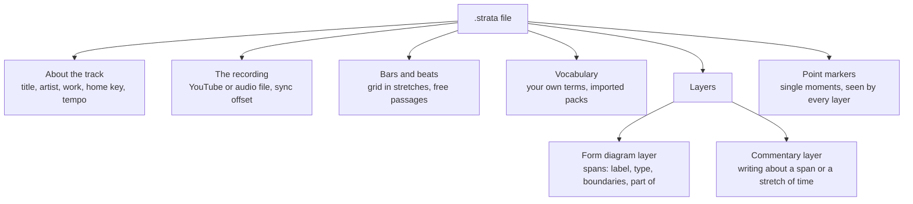

# The Strata file, explained

A `.strata` file holds one complete analysis of one recording: every layer, section, moment, comment, and term you used. You can keep it, send it, or publish it. This guide explains what the file records and what each part means, in the terms an analyst would use. You never need to open the file to use Strata. Read this when you want to know exactly what your analysis says as data.

The file is plain text in a common format called JSON. You can open it in any text editor. A programmer can read it from any programming language. Where a part has a technical name inside the file, this guide shows it `like this` for anyone who needs it. For the structure as JSON, with a complete example, read [How the JSON is structured](../docs/json-structure.md).

## At a glance

The details about the track, its timing, and its vocabulary sit at the top. The analysis itself lives in the layers, mostly as spans. Commentary sits alongside the spans. Point markers belong to the whole analysis, so every layer sees them. The sections below explain each part.

## About the recording

The top of the file says what you analyzed and who analyzed it. Only the title and artist are always present. You fill in the rest when you know it, mostly in **Document settings**.

| Detail | What it records | Example | In the file |
| --- | --- | --- | --- |
| Title | The track or recording | Alive | `title` |
| Artist | Performers, as a list, so collaborations stay clean | Krewella | `artist` |
| Context | Studio recording, or live performance | performance | `context` |
| Composer | Strata asks for it when the context is a performance | Beethoven | `composer` |
| Work | The composition, so you can compare performances of it across files | Piano Sonata Op. 13 | `work` |
| Derived from | A remix, cover, or re-recording of another analyzed track, and the relationship. Strata keeps it in the file but has no control for it yet | remix of heroes-original.strata | `derivativeOf` |
| Home key | Tonic and mode. You write key areas and harmonic labels relative to it | A minor | `homeKey` |
| Starting tempo and meter | Where the beat grid starts. Once you have a grid, the grid holds the real tempo, including any changes | 128 BPM, 4/4 | `bpm`, `timeSignature` |
| Length | The recording's length in seconds. Strata fills it in from the media | 300.5 | `duration` |
| Notes | Your overview: method, caveats, or a summary of findings | — | `notes` |
| Project | A tag for a collection of analyses that belong together. Strata keeps it for corpus tools and does nothing else with it yet | edm-corpus | `project` |
| Analysis by | Who made the analysis | — | `analysisAuthor` |
| Cadence captions | Whether Strata draws cadence details on the diagram. They stay on until you turn them off | on | `showCadenceCaptions` |

The file also records when you created it, when you last saved it, which version of Strata wrote it, and which version of the format it uses (`createdAt`, `updatedAt`, `strataVersion`, `fileFormatVersion`).

**Derived from** (`derivativeOf`) holds two things: `sourceTrack`, the file name of the other analysis, and `relationship`. You can write any relationship, but these are the suggested ones: `remix`, `cover` (a cover performance of the same composition), `rerecording` (the original artist recorded the track again), and `arrangement` (for different instruments or a different setting). Strata keeps this apart from the context, so you can ask about either one on its own.

## The recording and its timing

Strata measures every time in seconds from the true start of the music. Strata calls this **recording time**. The file links to the recording but never contains it.

- **The source** (`source`) is either a YouTube video (`type: "youtube"` with its `url`) or an audio file on your own computer (`type: "local"` with only its `filename`). Anyone can open a YouTube analysis. To open an audio-file analysis, a reader needs the same file.
- **The sync offset** (`sourceOffset`) is how far into the video the music actually starts. If a video has a 3-second intro, the offset is 3. Strata then plays a section at 1:34 of the music from 1:37 of the video.

Because the music keeps its own clock, you can replace a broken upload with a better one. Change the link and the offset. Every section, marker, and comment stays where it was.

## Bars and beats

The beat grid (`beatGrid`) gives the recording bar numbers. It is optional. You lay it down by ear: tap along, type a tempo, or match a click track to the recording.

Strata stores the grid as a few **stretches** rather than as individual beats. Each stretch starts on a downbeat and keeps one tempo and one meter. You start a new stretch to mark a tempo or meter change. Between two stretches there can be no grid at all. That is how you record a rubato introduction or an unmetered breakdown.

| Part of a stretch | What it means | In the file |
| --- | --- | --- |
| Identity | A permanent internal code | `id` |
| Start | The time of its first downbeat | `start` |
| End | Where the beat stops and a free passage begins. Leave it out to run the stretch to the next one or to the end of the track | `end` |
| Tempo | Beats per minute, to a thousandth if the track needs it (158.9) | `bpm` |
| Beats in a bar | The meter's top number | `beatsPerBar` |
| Beat unit | The meter's bottom number, for display. Leave it out for 4 | `beatUnit` |
| First bar number | The bar number at the start. Leave it out to keep counting from the stretch before, across any free passage. Set it to renumber | `firstBar` |

Strata works out every beat and bar line from these few numbers. When you correct a tempo, you change one number. Every bar line after it moves with it.

## Layers

A layer (`layers`) holds one reading of the timeline: large-scale form, sections, phrases, or one framework's view of the piece. A file can hold as many layers as your analysis needs. You can give your layers different focuses, frameworks, and vocabularies within the same analysis.

There are two kinds today:

- **Form diagram layers** (`type: "form-diagram"`) hold spans, the sections drawn as brackets.
- **A commentary layer** (`type: "written-analysis"`) holds your written commentary. Strata makes one the first time you write commentary. You never manage it directly.

Within one form layer, spans never overlap. You lay a layer's sections end to end, with gaps where you make no claim. When two readings overlap, put them on two layers.

Each layer also carries its own settings:

| Setting | What it does | In the file |
| --- | --- | --- |
| Identity | A permanent internal code | `id` |
| Kind | Form diagram or commentary | `type` |
| Content | The layer's spans or commentary | `data` |
| Name and description | The name beside the layer, and an optional longer note on its framework ("Phrase-level hypermeter, 4-bar units") | `label`, `description` |
| Shown or hidden | Strata leaves hidden layers out of exports | `visibility` |
| Locked | You can view a locked layer but not edit it | `locked` |
| Place in the stack | Which layer sits above which. When you group or copy spans, Strata uses it to decide which span is the parent | `displayOrder` |
| Default colors | Fill and outline for spans that have no color of their own, or no color at all (`"none"`) | `fillColorDefault`, `strokeColorDefault` |
| Shape | Brackets, or thin flat bars (suited to a layer of key areas) | `spanShape` |
| Library | The vocabulary you usually draw this layer's types from. It's a preference only: you can use any type | `library` |
| Filling gaps | Whether a boundary in an empty stretch fills the stretch on both sides or starts a span there, for a layer that begins partway through | `fillGaps` |
| Text size | Small, medium, or large labels | `fontScale` |

Two more settings have no control in the app yet. When a file sets where a layer's labels and annotations sit (`rendering`), Strata draws them there. Strata reserves `position`, above or below the time ruler, for later.

Strata keeps a layer of a kind it doesn't know unchanged in the file, so a file made by a newer version loses nothing.

## Spans

A span (`spans`) is a stretch of the recording that you claim as a section: a verse, a drop, an exposition, or a four-bar phrase. Apart from its start and end, everything on a span is optional.

| On a span | What it records | Example | In the file |
| --- | --- | --- | --- |
| Start and end | Where the section begins and ends, in recording time | 94.5 to 125.0 | `startTime`, `endTime` |
| Label | Your name for it, in your words | THE DROP | `label` |
| Short label | A shorter form Strata draws when the full label doesn't fit | Dr | `shortLabel` |
| Type | What kind of section it is, from the vocabulary | drop | `type` |
| Annotation | A short observation Strata draws on the span itself | filter sweep → snare roll | `annotation` |
| Notes | Your own working note. Strata shows it only in the Inspector and never exports it. You save it in the file with everything else, so anyone you send the file to can read it | check the bass entry | `notes` |
| Lyrics | The words sung in this stretch, which Strata shows with it in the commentary panel | — | `lyrics` |
| Key area | A Roman numeral relative to the home key, which Strata draws as a caption across the span | ♭VI | `keyArea` |
| Start and end boundary | What kind of transition happens at each end (below) | Gradual | `startBoundaryType`, `endBoundaryType` |
| Part of | The span on another layer this one belongs to (below) | Verse 2 in Sections | `parentId` |
| Made by merging | The spans you merged into this one | — | `mergedFrom` |
| Link name | A short name made from the label, for commentary links and embeds | drop-2 | `slug` |
| Identity | A permanent internal code you never see | — | `id` |

### Label, type, and link name are different on purpose

The **label** is yours: "THE DROP", "Main Drop", and "Drop 1" are all fine. The **type** is the shared category, `drop`. With it, someone can count every drop across a hundred analyses, whatever each analyst called them. Commentary and embeds point at a span by its **link name**. Strata makes it from the label. Once you save the file, the link name stays fixed even if you rename the span, so your links keep working.

### What the music does, and how you draw it

Strata keeps your analytical claim about a boundary separate from the way you draw the bracket.

The **boundary type** is the claim. You make it for each end of a span:

| Boundary | Meaning | Example |
| --- | --- | --- |
| Clean (the default) | A clear cut at one moment | A drop hit; a downbeat attack |
| Gradual | The new section emerges through a process. The boundary marks where it has arrived | A riser that becomes the drop; a fade-in |
| Elided | The end of one section is also the start of the next | A cadence that begins the next phrase; a drop that also starts the outro |

In the file, a clean boundary is `definite`, and the other two are `gradual` and `elided`. You mark an elision on each side separately, so one span can claim it while its neighbor does not. The two spans still meet at one exact moment. The overlap you see is only drawn.

The **drawing** is your visual choice: the shape of each end (rounded, square, angled, open, or an elision end that reaches past the boundary), a solid or dashed line, fill and outline colors (or none), a faint pattern over the fill (hatching, cross-hatching, dots, or lines), and which of two elided brackets sits on top. In the file, these are `startCap`, `endCap`, `lineStyle`, `fillColor`, `strokeColor`, `fillPattern`, and `endOnTop`. When you choose a boundary type, Strata suggests a matching end shape. You can then change it. None of these drawing choices records anything about the music.

### Linking the levels

A span can belong to a span on another layer: a phrase to its section, or a section to a rotation. Strata records this as **part of** (`parentId`). Strata sets it when you group spans into a span on another layer or copy a span to another layer. Of a span and its copy, the one on the higher layer is the parent.

When you drag a section's end, Strata moves the phrase that ends there with it. Unlink the spans to stop that. When you split a parent, each child goes with the half that holds most of it. When you merge parents, their children move to the merged span. When you delete a parent, Strata unlinks its children. Strata doesn't check that a phrase sits inside its section.

## Point markers

A point marker (`pointMarkers`) marks a single moment rather than a stretch: a cadence, a key change, a medial caesura, an energy peak, or simply a moment to come back to. Markers belong to the whole analysis rather than to one layer, because the event happens once in the recording. Every layer can see it.

| On a marker | What it records | Example | In the file |
| --- | --- | --- | --- |
| Time | The moment, in recording time | 64.2 | `timestamp` |
| Label | Your name for it | MC | `label` |
| Type | What kind of event, from the vocabulary | medial caesura | `type` |
| In key | A Roman numeral relative to the home key, which Strata captions with the type | V (drawn as V:HC) | `harmonicContext` |
| Absent | The event was expected here and doesn't happen. Strata strikes through the caption | an evaded cadence | `absent` |
| Flagged | A bookmark for a moment you want to come back to | — | `flagged` |
| Notes | A longer observation about the event | — | `notes` |
| Kind | Cadence, key change, tempo change, flag, or other. It decides only which fields the marker's panel shows first. Any marker can carry any field | cadence | `kind` |
| Link name | The name you use to link to it from commentary | mc | `slug` |
| Identity | A permanent internal code you never see | — | `id` |

You can use one structure for two purposes. For a quick flag, you usually leave out the type and set the bookmark. For a precise analytical event, such as a medial caesura or an essential expositional closure, you give the marker a type. Then you can count it across analyses like any span type. Because you can mark an event as absent, a missing event becomes data too.

## Vocabulary

Your types come from a vocabulary: a list of terms, each with a permanent id, a readable name, and a short explanation. When analysts use the same terms, you can compare their analyses.

- Strata ships its built-in libraries with the app rather than in the file: General, Pop/Rock, Song form, EDM, Common practice, Jazz, and Form letters, plus optional packs such as Caplin's formal functions and Sonata Theory. A file refers to a built-in term by its id alone.
- You save your own terms in the file (`vocabulary`), in three lists: span types (`spanTypes`), point marker types (`pointMarkerTypes`), and modes (`modes`, for home keys beyond major, minor, and the church modes). Strata saves the form letters you make (A, A′, B″) there too.
- You share a set of terms with other analysts as a pack (a `.vocab.json` file). When you import one, Strata copies its terms into the file and marks them with the pack's name and version. The analysis still opens for someone who doesn't have the pack.
- You can link a specific term to a general one as a **broader** term. A Caplin transition counts as a transition, so when you search for all transitions, you find it alongside Sonata Theory's TR zone.

A term's id never changes meaning inside a file, because a corpus query looks for the id. You can reword a term's name and explanation freely.

### The parts of a term

| Part | What it records | In the file |
| --- | --- | --- |
| Id | The permanent name a span or marker uses as its type: lowercase letters, numbers, and hyphens. If you change it, you break queries against existing files | `id` |
| Name | What the Type picker shows | `label` |
| Explanation | The tooltip you see while choosing a type | `description` |
| Color | An optional default color. Strata keeps it but doesn't draw with it yet | `color` |
| List | `span`, `point-marker`, or `mode`: which list the term goes in when you import a pack | `kind` |
| Pack | The pack it came from, such as `My Pack v1.0.0`. Terms you made in this file have none | `source` |
| Broader terms | The more general terms it counts as in a query, such as `["transition"]` on a Caplin transition | `broader` |

### Vocabulary packs

A pack is a separate `.vocab.json` file, described by [`strata-vocab.schema.json`](strata-vocab.schema.json). It isn't part of a `.strata` file.

| Part | What it records | In the file |
| --- | --- | --- |
| Pack marker | Marks the file as a Strata pack. Strata writes it when you export | `strataVocabPack` (the number 1) |
| Name | The pack's name, which the Type picker shows as a group | `name` |
| Version | The pack's version, such as `1.0.0` | `version` |
| Author and description | Who made it and what it covers | `author`, `description` |
| Terms | The terms, each with its list (`kind`) | `terms` |

When you import a pack, Strata leaves out and names any term whose id the app already ships or the file already defines, so an id never changes meaning inside a file. When you import the same pack again, in any version, Strata replaces its earlier terms. To export your own terms as a pack, use **Save your types as a pack** in the Libraries dialog, which you open from the Type picker. Strata leaves out form letters and terms from other packs.

## Commentary

Commentary is your written analysis, tied to the timeline (`blocks`, inside the commentary layer). You write each piece about one span or about a stretch of time. Strata shows it above the diagram while that passage plays. A span carries at most one piece.

- You write in Markdown: paragraphs, bold, italic, headings, lists, quotes, code, and web links. If you don't know the syntax, use the toolbar.
- To link to a span or marker, put its link name in double brackets: `[[drop-2]]` shows the span's label, and `[[drop-2|the second drop]]` shows your own words. The link button in the commentary editor writes the second form for you. Click a link to jump to that moment. If you link to a name that no longer exists, Strata shows the words as plain text.
- You don't lose writing when you edit elsewhere. When you merge two spans, Strata combines their commentary on the merged span. When you delete a span, its commentary stays, attached to the stretch of time the span covered.

For safety, Strata never runs code or loads anything from elsewhere in shared commentary. It shows HTML as typed and leaves out images.

| On a piece of commentary | What it records | In the file |
| --- | --- | --- |
| Identity | A permanent internal code | `id` |
| Anchor | What the piece is about: a span, by its identity (`{ "spanId": … }`), or a stretch of time (`{ "start": …, "end": … }`) | `anchor` |
| Text | Your writing, in Markdown | `text` |

## What the format takes a stand on

These commitments shape everything above. They are theoretical positions as much as technical ones.

- **Hold several frameworks at once.** Put two readings of the same passage on two layers, side by side. Within a layer, you lay sections end to end, so each layer stays one consistent reading.
- **Compare analyses by type.** You use labels for people and types for questions across many analyses, such as how long a typical verse lasts.
- **Keep the music and the drawing separate.** A boundary type is a claim about the music. A dashed line or an angled end is a choice about the picture. You can change one without touching the other.
- **Write down only what differs from the ordinary case.** If you leave out a boundary type, Strata reads it as a clean cut. If you leave out a flag, Strata reads the marker as not flagged.
- **Measure time from the music.** Every time counts from the start of the music, so your analysis survives a change of video.
- **Keep everything in one file:** vocabulary, layers, spans, markers, and commentary. There is no server, no account, and nothing else to keep in step.

### Format versions

Each file records the version of the format it uses (`fileFormatVersion`). When Strata adds an optional detail, the version stays the same. When a change means older files need upgrading, the version goes up. Strata upgrades an older file when you open it. If you open a file from a newer version, Strata warns you and never downgrades it.

| Version | What changed |
| --- | --- |
| 2 (October 2026) | Removed three details that were unused or unwanted: a shared pool of time points (`sharedTimePoints`; the beat grid took over its job), a hierarchy setting on each layer that Strata never used (`hierarchicalEnforcement`), and a confidence rating on spans and markers (`confidence`). Strata drops them when it opens a version-1 file. Colors may now be `"none"`. |
| 1 | The first published format. |

---

*Technical spec: [`strata.schema.json`](strata.schema.json) · TypeScript types: [`src/types/strata.ts`](../src/types/strata.ts) · Examples: [`example.strata`](example.strata) and [`public/demos/alive.strata`](../public/demos/alive.strata), both written in version 1 and upgraded when you open them.*
